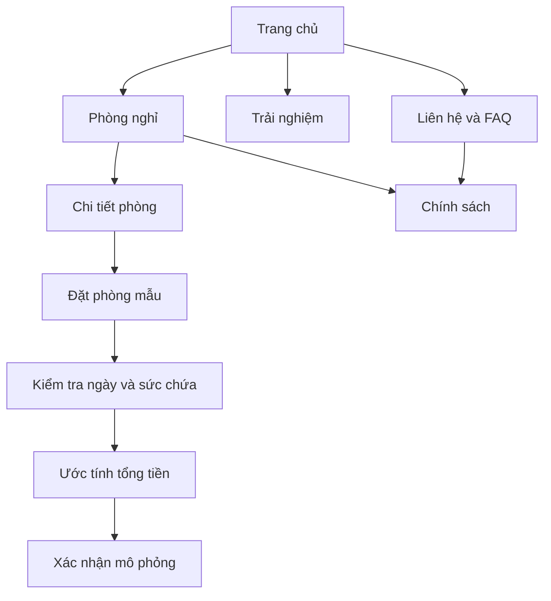
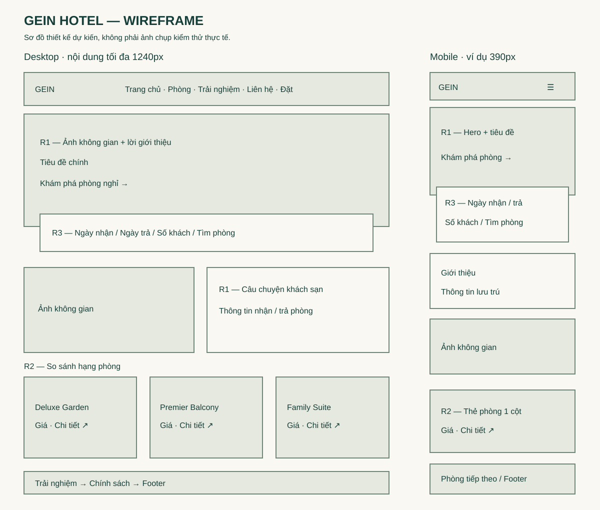

# Thiết kế Gein Hotel

## Đánh giá phương án

Hai phương án được so sánh ở mức ý tưởng, không phải hai website đã được người dùng thử nghiệm.

| Tiêu chí               | A — Một trang dài           | B — Nhiều trang theo tác vụ                   |
| ---------------------- | --------------------------- | --------------------------------------------- |
| Tìm bảng giá           | Cần cuộn nhiều hoặc bấm neo | Trang phòng riêng, có URL trực tiếp           |
| Đọc chính sách         | Làm trang chủ dài           | Tách trang, giữ trang chủ dễ đọc              |
| Triển khai tĩnh        | Đơn giản                    | Vẫn đơn giản với đường dẫn tương đối          |
| Bảo trì menu           | Một bản menu                | Cần đồng bộ menu trên 5 tệp HTML              |
| Phù hợp mục tiêu đồ án | Minh họa nhanh              | Thể hiện cấu trúc trang và luồng nghiệp vụ rõ |

Chọn B vì khách cần so sánh giá, đọc quy định và liên hệ ở những thời điểm khác nhau. Chấp nhận việc lặp khung menu/chân trang trong HTML để website mở được trực tiếp, không phụ thuộc trình sinh hoặc framework. Nếu đổi menu phải cập nhật cả 5 trang và chạy lại kiểm tra liên kết.

## Bản đồ trang và luồng chính

## Wireframe rộng và hẹp

Sơ đồ thể hiện ý định bố cục, không phải ảnh chụp kết quả chạy hoặc bằng chứng responsive đã đạt.

| Quyết định                                 | Yêu cầu | Lý do và đánh đổi                                                     |
| ------------------------------------------ | ------- | --------------------------------------------------------------------- |
| Nút đặt phòng nằm trong menu chung         | R3, R4  | Người xem luôn có lối bắt đầu; trên mobile nút nằm trong menu mở rộng |
| 3 thẻ phòng song song trên desktop         | R2      | So sánh giá/sức chứa nhanh; chuyển 1 cột ở màn hình hẹp để đọc dễ     |
| Thanh tìm phòng ở phần đầu trang chủ       | R3      | Giảm bước tới hạng phù hợp; không quảng cáo là tra phòng trống        |
| Xanh đậm, kem, điểm nhấn vàng              | R1, R6  | Gợi không khí nghỉ dưỡng; dùng chữ tối trên nền sáng cho nội dung dài |
| Serif cho tiêu đề, sans-serif cho thân bài | R1, R6  | Tách cấp thông tin; có Georgia/Arial dự phòng khi thiếu Internet      |
| Form có label, lỗi văn bản, aria-live      | R5, R6  | Dễ xác định dữ liệu cần nhập; không dựa riêng màu sắc                 |
| Hộp thoại HTML `dialog`                    | R2, R4  | Giữ ngữ cảnh so sánh; cần thử focus và Escape native ở browser thật   |

CSS có breakpoint 1000px và 760px; ở ≤760px menu thu gọn, thẻ phòng/form đổi một cột, khối tiện nghi hai cột. Khung nội dung giới hạn 1240px và có khoảng đệm hai bên. Có `prefers-reduced-motion`, `:focus-visible`, skip link và `@media print`.

## Thành phần và dữ liệu

- HTML: `header`, `nav`, `main`, `section`, `article`, `footer`; `lang=vi`, viewport và tiêu đề riêng.
- CSS: biến màu/phông, Grid/Flexbox, trạng thái nút, media query dùng chung.
- `data.js`: danh sách phòng và tiện nghi cố định; không chứa thông tin người dùng.
- `app.js`: ngày, bộ lọc, hộp thoại, xác nhận và lỗi; nhập liệu được đưa vào DOM bằng `textContent`.
- Ảnh JPG lưu trong `assets/images`; favicon SVG tự tạo. Nguồn ghi tại `NGUON_TAI_NGUYEN.md`.
- `scripts` và `tests` dùng cho phát triển/xác minh, không phải backend của website.

## Đánh giá khả dụng

Các tiêu chí rà soát là tính nhất quán menu, dễ so sánh giá, rõ phạm vi mô phỏng, nhãn nhập liệu, điều hướng bàn phím, responsive và thông tin phản hồi. Rà soát DOM xác nhận nhãn/heading/liên kết; các lỗi điện thoại và truy cập trường form đã được sửa. Chưa có ảnh desktop/mobile, số đo tương phản, đánh giá người dùng hoặc kiểm tra screen reader để kết luận toàn bộ khả dụng đã đạt.
